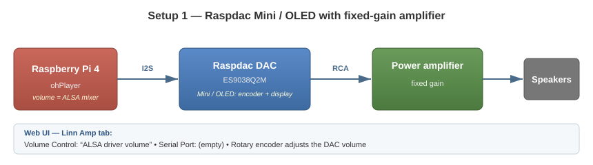
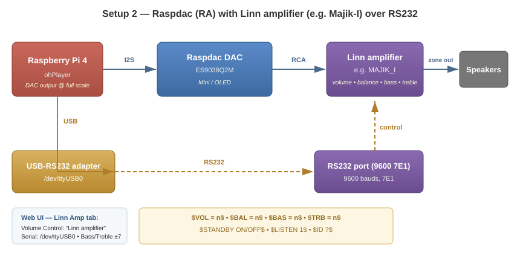

# ohPlayer (Audiophonics Raspdac Mini & KFR DSP Edition)

Forked from [openhome/ohPlayer](https://github.com/openhome/ohPlayer) and updated around `ohPipeline`/`TestMediaPlayer` with support for the Audiophonics Raspdac Mini interface, unified [KFR 7.2.0](https://github.com) resampling and FIR room-correction DSP, and a low-latency `ALSA_CAPTURE` live input source.

This fork also includes the hardware-specific configuration and installation guidance that was previously split across the legacy plain README.

## History

- **2026-11:** Migrated audio resampling from `libsoxr` to unified **KFR 7.2.0** (`C++20`) resampling + partitioned FFT FIR room correction (`KfrPcmProcessor`), added dual Music/TV low-latency DSP profiles (`< 200 Hz` minimum-phase bass correction for TV), added the `ALSA_CAPTURE` live USB/SPDIF input source, and automated dependency fetching via `fetch_deps.sh`.
- **2026-10-18:** Added external Linn Roomamp 2 support.
- **2026-09-04:** Synced back with AndreHro updates. This build remains primarily for `aarch64`, but it can be adapted to `armhf` if needed.
- **2025-04-19:** Redesigned around `ohPipeline` / `TestMediaPlayer` to stay aligned with current OpenHome stack releases (container/RPi build reference: [jchassin/ohContainerBuilder](https://github.com/jchassin/ohContainerBuilder)).
- **2021-10-16:** Added support for [Audiophonics Raspdac Mini LCD](https://www.audiophonics.fr/fr/lecteurs-reseau-open-source/audiophonics-raspdac-mini-lcd-kit-diy-lecteur-reseau-pour-raspberry-pi-4-dac-es9038q2m-p-15148.html).
- **Initial fork:** Added support for Audiophonics Raspdac Mini OLED screen.

Based on the [OpenHome Sample Players](https://github.com/openhome/ohPlayer) for macOS, Windows, Linux and Raspberry Pi.

---

## Features Added in This Fork

### 1. Unified KFR 7.2.0 Resampling & FIR Room Correction
- **Single-Pass DSP (`KfrPcmProcessor`):** Converts incoming OpenHome PCM to `f64` planar buffers, runs rational polyphase sample-rate conversion (`std::gcd` reduced factors) and partitioned FFT FIR convolution, and outputs `S32_LE` directly to ALSA hardware.
- **WAV Impulse Response Loader:** Supports mono `16/24/32-bit` PCM and `32-bit` IEEE float WAV files (including `WAVE_FORMAT_EXTENSIBLE`) and automatically resamples IR taps with unity DC-gain scaling when the WAV sample rate differs from the active stage rate.
- **Music vs. TV Low-Latency Profiles:**
  - **Music Sources (`Playlist`, `Radio`, `UPnP`, `AirPlay`):** Uses `kfr::resample_quality::high`, `1024`-sample FFT blocks, `8192`-frame ALSA buffer, and `ir_left.wav` / `ir_right.wav`.
  - **TV / Live Capture (`ALSA_CAPTURE`):** Automatically switches to `kfr::resample_quality::normal`, `256`-sample FFT blocks (`~5.3 ms` at `48 kHz`), `4096`-frame ALSA buffer, and dedicated minimum-phase `< 200 Hz` bass-correction filters (`ir_tv_left.wav` / `ir_tv_right.wav`, falling back to `ir_left.wav` / `ir_right.wav`).

### 2. Live ALSA Capture Source (`ALSA_CAPTURE`)
- Exposes a real-time `ALSA_CAPTURE` source (`alsacapture://default`) when built with `-DCAPTURE_ALSA` to route external USB/SPDIF audio (e.g., `plughw:1,0` at `48 kHz`) through KFR DSP to the DAC with `Latency::Internal` support and `PhaseAdjuster` clock-drift compensation (`~100 ms` total lip-sync latency).

---

## Hardware Setups

Two hardware configurations are supported, selected through the web configuration UI (presentation URL of the renderer, `Linn Amp` tab):

Hardware references:

- [Audiophonics Raspdac Mini LCD Kit](https://www.audiophonics.fr/fr/lecteurs-reseau-open-source/audiophonics-raspdac-mini-lcd-kit-diy-lecteur-reseau-pour-raspberry-pi-4-dac-es9038q2m-p-15148.html)
- [Audiophonics DAC I-Sabre ES9038Q2M](https://www.audiophonics.fr/fr/modules-dac-et-interfaces/audiophonics-dac-i-sabre-es9038q2m-raspberry-pi-i2s-spdif-pcm-dsd-alimentation-usb-c-p-12795.html) — tested with the ES9028 version, which has since been replaced by this one.

### 1. Raspdac Mini / OLED with fixed-gain amplifier

The simplest setup: the Raspdac Mini (LCD or OLED version) is connected to a power amplifier with fixed gain, and volume is controlled by the ALSA driver of the DAC.

- Volume control: **`ALSA driver volume`**
- The Raspdac rotary encoder adjusts the ALSA volume of the DAC
- No serial connection required



Web UI settings (`Linn Amp` tab):

| Setting | Value |
|---|---|
| Volume Control | `ALSA driver volume` |
| Serial Port | *(empty)* |

### 2. Raspdac Mini / OLED with Linn preamplifier (RA2) over RS232

The Raspdac is connected to a Linn preamplifier (e.g. Akurate Kontrol / RA2) through a USB-to-RS232 adapter. The preamp handles volume, balance, bass and treble; the DAC outputs at full scale.

- Volume control: **`Linn amplifier`**
- Serial port: e.g. **`/dev/ttyUSB0`** (USB-RS232 adapter, 9600 bauds, 7E1)
- Bass / Treble: -7 to +7, applied to the preamp at startup
- Standby: the on/off button of the control point app drives the preamp standby (`$STANDBY ON/OFF$`)
- The ALSA output is set to full scale; attenuation is delegated to the preamp
- Volume is limited by the `Volume.Limit` setting (as on a Linn DSM)



Web UI settings (`Linn Amp` tab):

| Setting | Value |
|---|---|
| Volume Control | `Linn amplifier` |
| Serial Port | `/dev/ttyUSB0` |
| Bass / Treble | -7 .. +7 |
| Detected Amplifier | `LR2` + serial (read-only, from `$ID ?$`) |

Behaviour:
- The DAC output is set to full scale; attenuation is handled by the preamp
- Volume is limited by the `Volume.Limit` setting (as on a Linn DSM)
- The standby button of the control point app drives the preamp standby

Settings are persistent and applied at the next start of the service (a reboot of the renderer, not of the Raspberry Pi, is enough: use the `Reboot` button of the web UI).

---

## Building on Linux / Raspberry Pi (`aarch64`)

### 1. Install Build Dependencies

```bash
sudo apt update
sudo apt install build-essential clang pkg-config curl unzip libglib2.0-dev libasound2-dev libssl-dev
```

### 2. Fetch OpenHome & Precompiled KFR 7.2.0 Dependencies

```bash
git clone https://github.com/jchassin/ohPlayer
cd ohPlayer
./fetch_deps.sh
```

`fetch_deps.sh` downloads the prebuilt OpenHome libraries (`ohNet`, `ohNetGenerated`, `ohMediaPlayer`, `ohWafHelpers`) and the official precompiled **KFR 7.2.0** release archive (`KFR-7.2.0-Linux-ARM64.zip` or `Linux-ARM.zip`) into `./dependencies/<platform>/`.

### 3. Build & Install

```bash
cd linux
make
sudo make install
```

---

## Running `openhome-player`

```bash
openhome-player --ir-dir /path/to/ir-directory
```

Place mono `.wav` room-correction impulse responses in `--ir-dir`:
- `ir_left.wav` / `ir_right.wav` — Full-range room correction for music playback.
- `ir_tv_left.wav` / `ir_tv_right.wav` — Minimum-phase `< 200 Hz` bass correction for low-latency TV/capture playback.

---

## Installation

### Prerequisites

Applicable to:

- `aarch64` target running Raspberry Pi OS (tested on Trixie)
- Required packages:
  - `build-essential`
  - `clang`
  - `libglib2.0-dev`
  - `libssl-dev`
  - `libasound2-dev`

Install the required packages with:

```bash
sudo apt update
sudo apt install build-essential clang libglib2.0-dev libssl-dev libasound2-dev
```

### Build

```bash
git clone https://github.com/jchassin/ohPlayer
cd ohPlayer
./fetch_deps.sh
cd linux
make
```

### Rebuild with the full OpenHome stack

For rebuilding with the full OpenHome stack (`ohNet`, etc.), see:

[ohContainerBuilder](https://github.com/jchassin/ohContainerBuilder)

### Deprecated

An Ansible playbook was created for non-Linn users (users without an account in the Linn domain):

[ohPlayer on Ansible Galaxy](https://galaxy.ansible.com/jchassin/ohplayer)

---

## Legacy Ansible Playbook & License

- **Ansible Playbook (historical):** [galaxy.ansible.com/jchassin/ohplayer](https://galaxy.ansible.com/jchassin/ohplayer)
- **Licensing:** The `ohPlayer` source code in this repository is licensed under the **MIT License** (`License.txt`). Precompiled KFR 7.2.0 binaries are licensed under **GPLv2+** (or a commercial KFR license).

---

A couple of additional scripts are needed. Message me if interested.
